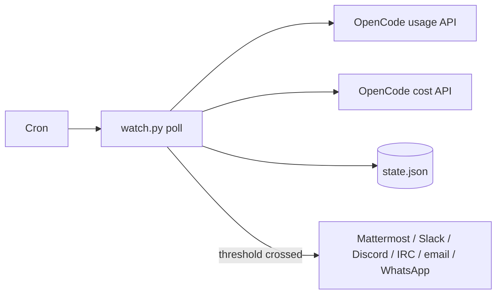

<div align="center">

# opencode-spend-watch

**Dollar-by-dollar alerts for OpenCode usage, wherever your team talks.**

<br>

[](https://github.com/cusae/opencode-spend-watch/actions/workflows/tests.yml)
[](https://github.com/cusae/opencode-spend-watch/actions/workflows/codeql.yml)
[](LICENSE)
[](#requirements)

<br>
<br>

</div>

A small Python watcher that reads exact OpenCode usage in USD and posts an
alert every time spend in the current billing period crosses another whole
dollar: Mattermost, Slack, Discord, IRC, email, or WhatsApp. It reports the amount used, the remaining monthly
allowance, the 5-hour, weekly, and monthly windows, today's spend, the top
models, and the limit with the least headroom.

Standard library only. No database. No secret in the repository.

---

## Features

- **Exact dollars.** Spend comes from the OpenCode Console, not from a local
  price table.
- **One alert per dollar.** A delivery failure is retried; a threshold is never
  skipped or duplicated.
- **Durable history.** Daily costs survive after they leave the API's 30-day
  window, so every billing period stays complete.
- **Full context.** Remaining allowance, window percentages and reset times,
  today and last-7-day spend, top models, closest per-model limit, console
  link.
- **Coloured severity.** Mattermost and Slack attachments, Discord embeds,
  and a status emoji turn amber at 50% used and red at 80%, using the higher
  of the monthly window and the closest model limit.
- **Many channels.** Mattermost, Slack, Discord, IRC, email, WhatsApp,
  Telegram, desktop notifications, and an RSS 2.0 feed can be enabled
  together; one failing channel does not block the others.
- **Percentage alerts.** 5-hour, weekly, and monthly windows alert at 50%,
  80%, and 95% by default, independently of the dollar thresholds.
- **Alert log.** Every delivery attempt is appended to a JSONL file for audit
  and later inspection.
- **More providers.** OpenRouter credits and OpenAI organization costs can be
  tracked alongside OpenCode Go with the same thresholds and channels.
- **Safe by default.** The OpenCode key is read read-only and never logged,
  printed, or sent. `config.env` is git-ignored and mode 600.
- **Cron-sized.** One process, one state file, one file lock, stdlib only.

---

## Quick start

```console
$ git clone https://github.com/cusae/opencode-spend-watch.git
$ cd opencode-spend-watch
$ cp config.example.env config.env
$ chmod 600 config.env
$ $EDITOR config.env          # set MATTERMOST_WEBHOOK_URL
$ python3 watch.py check
$ python3 watch.py test-webhook
$ ./install.sh
```

The first poll sends a startup message and takes the current spend as the
baseline. Alerts start at the next dollar.

---

## How it works



The watcher reads three undocumented OpenCode Console endpoints with the Go
key already stored locally:

| Endpoint | Data |
| --- | --- |
| `/zen/go/v1/usage` | 5-hour, weekly, monthly percentages and reset times |
| `/console/api/usage/cost-by-day?range=30d` | exact cost per UTC day |
| `/console/api/usage/models?range=30d` | exact cost per model |

Every channel gets the same content. Mattermost and Slack render a coloured
attachment, Discord a coloured embed, email an HTML colour bar; IRC and
WhatsApp receive plain text. Green below 50% used, amber from 50%, red from
80%. Startup is blue and a period reset is green. Severity uses the monthly
percentage and the closest model limit.

The billing period comes from the monthly `resetsAt` timestamp. Spend is the
sum of daily costs from the period start. The threshold level is
`floor(spend / step)`; a message is sent when that level increases.

See [docs/architecture.md](docs/architecture.md) for the data flow, state
schema, failure model, and API contract.

### Message format

```text
🟢 **OpenCode spend — threshold reached**
**$6.05** used this period (crossed $6.00).

Billing period: 27 Oct 2026 14:09 UTC → 27 Nov 2026 14:09 UTC
Monthly allowance: **4% used**, 96% left
Windows: 5-hour 0% · weekly 6% · monthly 4%

Today (UTC): **$1.63** · last 7 days: **$3.70**
Top models (30d): DeepSeek V4.1 Flash $3.86 · Claude Haiku 5.5 $0.69
Closest limit: **DeepSeek V4.1 Flash** — $196.14 left of $200.00 (98%)

[Open the console](https://opencode.ai/console/<org-id>/activity/overview?range=30d)
```

---

## Packages and platforms

Prebuilt Debian and RPM packages are attached to GitHub releases. Install the
downloaded file, copy the example configuration to `/etc`, then run the
wrapper:

```console
$ sudo apt install ./opencode-spend-watch_1.0.0_all.deb
$ sudo install -d -m 755 /etc/opencode-spend-watch
$ sudo install -m 600 -o "$USER" -g "$USER" \
    /usr/share/doc/opencode-spend-watch*/config.example.env \
    /etc/opencode-spend-watch/config.env
$ $EDITOR /etc/opencode-spend-watch/config.env
$ opencode-spend-watch check
```

RPM uses `sudo dnf install ./opencode-spend-watch-1.0.0-1.noarch.rpm` and the
same configuration path. FreeBSD and macOS run from a checkout.

Tested platforms: Debian 12/13, Ubuntu 22.04/24.04, CentOS Stream 10, FreeBSD
13/14, and macOS 14/15. `metadata.json` lists the dependency and OS matrix.
Package layout, local builds, and release steps are in
[docs/packaging.md](docs/packaging.md).

## Requirements

- Python 3.10 or later, standard library only
- OpenCode with the OpenCode Go integration connected
- At least one notification channel: Mattermost, Slack, Discord, IRC, email, WhatsApp, Telegram, desktop, or RSS
- Linux or macOS for cron; systemd timers work too

---

## Installation

1. Create at least one notification destination: a Mattermost or Slack
   Incoming Webhook, a Discord webhook, an IRC channel, an SMTP account, or a
   WhatsApp Cloud API app. The [operations guide](docs/operations.md) lists the
   fields for each.
2. Create the configuration:

   ```console
   $ cp config.example.env config.env
   $ chmod 600 config.env
   ```

3. Fill in at least one channel. Keep webhook values quoted if they contain
   `&`, `?`, or `#`.
4. Validate the key, APIs, and every configured channel:

   ```console
   $ python3 watch.py check
   $ python3 watch.py test-webhook
   ```

5. Install the cron job (default: every 15 minutes):

   ```console
   $ ./install.sh
   ```

`install.sh` is idempotent. It rewrites only its own crontab entry, identified
by `# opencode-spend-watch`.

---

## Configuration

| Variable | Default | Meaning |
| --- | --- | --- |
| `MATTERMOST_WEBHOOK_URL` | empty | Mattermost Incoming Webhook. |
| `PLAN` | `go-plus` | `go-plus` or `go`; selects limits from `limits.json`. |
| `THRESHOLD_STEP_USD` | `1` | Dollar step, all providers; any positive value, including decimals. |
| `CRON_INTERVAL_MINUTES` | `15` | Minutes between cron checks (1–59). |
| `STATE_DIR` | `~/.local/state/opencode-spend-watch` | State, lock, cron log. |
| `OPENCODE_DB` | `~/.local/share/opencode/opencode.db` | Key source. |
| `OPENCODE_GO_KEY` | unset | Optional key override. |
| `CONSOLE_URL` | empty | Link added to each message. |
| `PERCENT_THRESHOLDS` | `50,80,95` | Percentage levels for window alerts. |
| `STARTUP_MESSAGE` | `true` | Send the first-run message. |
| `RESET_MESSAGE` | `true` | Send a message when the period resets. |
| `LIMITS_FILE` | `limits.json` | Per-model monthly limits. |
| `ALERT_LOG` | `STATE_DIR/alerts.log` | JSONL delivery log. |
| `RSS_FEED` | empty | RSS 2.0 file to append alerts to. |
| `RSS_TITLE` | `OpenCode Spend Alerts` | Feed title. |
| `RSS_LINK` | empty | Feed channel link. |
| `RSS_MAX_ITEMS` | `100` | Items retained in the feed. |
| `PROVIDERS` | `opencode` | Add `openrouter` and/or `openai`. |
| `OPENROUTER_API_KEY` | empty | OpenRouter credits API key. |
| `OPENROUTER_BUDGET_USD` | `0` | Budget; 0 uses purchased credits. |
| `OPENAI_ADMIN_KEY` | empty | OpenAI organization admin key. |
| `OPENAI_ORG_ID` | empty | Optional OpenAI organization header. |
| `OPENAI_BUDGET_USD` | `0` | Monthly OpenAI budget; 0 disables remaining. |

At least one channel is required; several can run together. Delivery is
isolated per channel: a broken backend is logged and the healthy ones still
receive the alert.

| Channel | Variables |
| --- | --- |
| Mattermost | `MATTERMOST_WEBHOOK_URL` |
| Slack | `SLACK_WEBHOOK_URL` |
| Discord | `DISCORD_WEBHOOK_URL` |
| IRC | `IRC_HOST`, `IRC_PORT`, `IRC_TLS`, `IRC_NICK`, `IRC_CHANNEL`, `IRC_PASSWORD` |
| Email | `SMTP_HOST`, `SMTP_PORT`, `SMTP_SECURITY`, `SMTP_USER`, `SMTP_PASSWORD`, `EMAIL_FROM`, `EMAIL_TO` |
| WhatsApp | `WHATSAPP_TOKEN`, `WHATSAPP_PHONE_NUMBER_ID`, `WHATSAPP_TO`, `WHATSAPP_API_VERSION` |
| Telegram | `TELEGRAM_BOT_TOKEN`, `TELEGRAM_CHAT_ID` |
| Desktop | `DESKTOP_NOTIFY=true` (`notify-send`, or `osascript` on macOS) |
| RSS | `RSS_FEED` points at a writable XML file; subscribe via a local web server, Nextcloud, or any static host |

IRC defaults to port 6697 with TLS, SHA-256 verified by the system trust
store. Email uses STARTTLS by default; `SMTP_SECURITY` accepts `starttls`,
`ssl`, or `none`. WhatsApp uses the Meta Cloud API. `EMAIL_TO` accepts a
comma-separated list.

OpenCode Go is always tracked. `PROVIDERS=opencode,openrouter,openai` adds the
other cost sources:

| Provider | Source | Budget |
| --- | --- | --- |
| OpenRouter | `/api/v1/credits` | purchased credits, or `OPENROUTER_BUDGET_USD` |
| OpenAI | organization costs, current month | `OPENAI_BUDGET_USD` |

OpenRouter alerts compare cumulative usage, and show the remaining credit.
OpenAI alerts use the current calendar month and show the remaining budget when
one is set.

All outputs are described in [docs/outputs.md](docs/outputs.md): chat
channels, email, desktop, RSS, the JSONL audit log, and release assets. That
page includes a web-server example for subscribing to the RSS feed.

The full runbook, including rotation and recovery, is in
[docs/operations.md](docs/operations.md).

---

## Command line

| Command | Effect |
| --- | --- |
| `watch.py poll` | One collection and alert cycle; cron calls this. |
| `watch.py check` | Validate the key, APIs, webhook, and plan limits. |
| `watch.py report` | Print the message without sending it. |
| `watch.py test-webhook` | Send one test message. |
| `watch.py daemon` | Poll every `OSW_INTERVAL` seconds (default 300). |
| `watch.py --version` | Print the version. |
| `watch.py --help` | Print the usage. |

Exit codes: `0` success, `1` API or delivery failure, `2` configuration error
or missing webhook.

---

## Spend semantics

- The period starts one calendar month before the API's monthly `resetsAt`.
- Daily costs are UTC buckets; the first day can include a few minutes before
  the exact start.
- The first run baselines at the current spend; past dollars are not replayed.
- If several dollars are crossed between polls, one message reports the range.
- The console API lags a few minutes, so an alert can arrive just after the
  dollar was spent.
- This tracks the Go allowance, not the flat subscription charge or
  pay-as-you-go credits outside Go.

---

## Troubleshooting

| Symptom | Action |
| --- | --- |
| `key: FAIL` | Reconnect OpenCode Go, or set `OPENCODE_GO_KEY`. |
| `HTTP 401` | The key was rejected; reconnect Go and rerun `check`. |
| `HTTP 404` | A console endpoint changed; open an issue with the path. |
| Test message `failed` | Recreate the webhook and update `config.env`. |
| No alerts | Run `report`; inspect `~/.local/state/opencode-spend-watch/cron.log`. |
| Cron never runs | Check `systemctl status cron` and `crontab -l`. |

More cases and recovery steps: [docs/operations.md](docs/operations.md).

---

## Security

- `config.env` holds webhook URLs, SMTP credentials, and the WhatsApp token;
  it is git-ignored and mode 600.
- The OpenCode key stays in OpenCode's database and is read read-only.
- No key material appears in logs or messages.
- Webhook URLs are validated before every delivery; IRC uses TLS by default.
- Never commit `config.env`, a webhook URL, a password, a token, a key, or an
  org ID.

Report vulnerabilities privately through
[GitHub Security Advisories](https://github.com/cusae/opencode-spend-watch/security/advisories/new).
See [SECURITY.md](SECURITY.md).

---

## Development

```console
$ make setup          # pip install -r requirements-dev.txt
$ make hooks          # use the repository commit hook
$ make check          # every check
$ make changelog      # regenerate CHANGELOG.md from commits
```

`make check` runs ruff, shellcheck, yamllint, ruff format, mypy --strict,
coverage (90% gate), bats, markdownlint, and workflow lint. `make changelog`
needs [git-cliff](https://git-cliff.org). CI runs the same
checks, plus a Python 3.10–3.14 matrix, CodeQL, and Dependabot.

| Path | Content |
| --- | --- |
| `watch.py` | the watcher |
| `notify.py` | notification backends, including RSS |
| `providers.py` | OpenRouter and OpenAI cost sources |
| `cliff.toml` | changelog and release-notes configuration |
| `metadata.json` | dependency and operating-system matrix |
| `debian/`, `packaging/rpm/` | Debian and RPM package recipes |
| `limits.json` | per-model monthly limits and display names |
| `install.sh` | validation and cron installation |
| `test/python/` | unit tests |
| `test/shell/` | bats tests |
| `docs/` | architecture and operations |

`CHANGELOG.md` is generated from Conventional Commits by
[git-cliff](https://git-cliff.org) (`make changelog`). Do not edit it by hand.
A `v*` tag triggers `.github/workflows/release.yml`, which publishes a GitHub
release with the generated section.

Contribution rules: [CONTRIBUTING.md](CONTRIBUTING.md) and
[AGENTS.md](AGENTS.md). Release history: [CHANGELOG.md](CHANGELOG.md).

---

## License

GPL-3.0-or-later. See [LICENSE](LICENSE).
