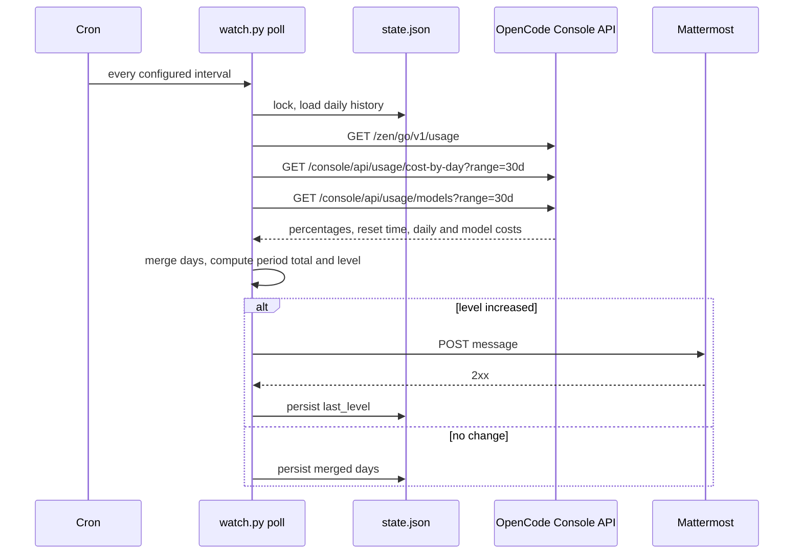

# Architecture

## Purpose

`watch.py` turns OpenCode usage into dollar-threshold events. It reads the same
numbers as the OpenCode Console, keeps a local history, and posts to Mattermost
when the current billing period crosses another whole dollar.

## Components

| Component | Responsibility |
| --- | --- |
| `Config` | Parse `config.env`, validate the threshold, expose plan limits and labels. |
| `opencode_go_key` | Read the Go key from OpenCode's database, or from `auth.json` as a fallback. |
| `fetch_windows` | Read 5-hour, weekly, and monthly percentages and reset times. |
| `fetch_daily` | Read exact cost per UTC day. |
| `fetch_models` | Read exact cost per model for the last 30 days. |
| `collect` | Merge stored and fresh days, compute the period total, today, the last 7 days, and the closest limit. |
| `build_message` | Render the Mattermost Markdown. |
| `post_webhook` | Validate the URL and deliver a coloured attachment with retries. |
| `Store` | Serialize a poll with a file lock and persist `state.json`. |
| `poll` | Initialize, detect period resets, raise thresholds, deliver, persist. |

## Data flow



A failed collection or delivery exits non-zero and leaves `last_level`
unchanged. The next poll retries, so an alert is delayed, never lost.

## Billing period

The period comes from the monthly `resetsAt` returned by the usage endpoint,
not the calendar month. The start is the same instant one calendar month
earlier, clamped to the length of the target month.

```text
period_end   = usage.monthly.resetsAt
period_start = subtract_month(period_end)
period_total = sum(cost(day) for day in days if day >= period_start.date())
```

Daily costs are UTC-day buckets. The first day of a period can include usage
from before the exact start instant; the endpoint does not expose finer
granularity.

## Thresholds

```text
level = floor(period_total / THRESHOLD_STEP_USD)
```

A message is sent when `level` increases. If several dollars are crossed
between polls, one message reports the range. `last_level` is advanced only
after Mattermost accepts the message.

The first run sends a startup message, then records the current level as the
baseline. Earlier spend is not replayed.

## State

`state.json` lives under `STATE_DIR` (default
`~/.local/state/opencode-spend-watch`).

```json
{
  "period_end": "2026-11-27T14:09:59+00:00",
  "initialized": true,
  "last_level": 5,
  "daily": {
    "2026-11-07": 0.2599,
    "2026-11-08": 1.4528
  }
}
```

`daily` is the durable part: it keeps days after they leave the API's 30-day
window. `last_level` is the delivery checkpoint. `period_end` detects a
billing-period reset. A corrupt state file is treated as empty.

## API contract

| Endpoint | Auth | Shape used |
| --- | --- | --- |
| `/zen/go/v1/usage` | Bearer Go key | `usage.{rolling,weekly,monthly}.{percent,resetsAt}` |
| `/console/api/usage/cost-by-day?range=30d` | Bearer Go key | `[{date, totalCostMicroCents}]` |
| `/console/api/usage/models?range=30d&page=N&pageSize=50` | Bearer Go key | `{items: [{provider, model, totalCostMicroCents, totalRequests}], pageInfo}` |

Costs are microcents: 1 USD = 100,000,000. The endpoints are undocumented and
may change; `check` and the cron log identify the failing path.

## Design decisions

- **Standard library only.** The watcher runs from cron on a workstation with
  no virtualenv. Development tools are isolated in `requirements-dev.txt`.
- **Authoritative dollars, local percentages.** Spend comes from the console
  API; window percentages come from the usage endpoint. The watcher does not
  re-price tokens.
- **Durable daily history.** A 30-day API window would silently drop the start
  of a long period; the state file prevents that.
- **Idempotent delivery.** Advancing the checkpoint only after a 2xx response
  makes retries safe.
- **Severity in the payload.** Mattermost renders an attachment colour bar;
  the colour and the status emoji share one severity calculation.
- **One lock.** Cron, a manual poll, and `report` serialize on a file lock in
  the state directory.
